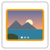

# Photo frame and screensaver

  

Two widgets for vis-2, also as web components, and a backend for the albums:

- **Photo frame** — family photos as a tile in the grid, as a whole page on a wall tablet or anywhere on a view:
  cross-fade or slide, a slow zoom, "show whole" with a blurred copy of the picture instead of black bars, two
  portrait photos side by side, date and place from EXIF/XMP, swipe and tap, an optional large clock and weather card.
- **Screensaver** — after some minutes without input the photos with clock and weather lie over every view of the
  project. A touch ends it without switching anything under it. It can be set per project or per view, switched off
  or dimmed at night by a state, and return to a fixed view.

The pictures come from a folder of the ioBroker file storage (new pictures appear without a restart), from a list of
URLs, from a state that a script or an adapter fills, or from an **album of the adapter**: a folder of the ioBroker
files, a folder of the server, [Immich](https://immich.app) or Google Photos (as an ambient device), filtered by date (the last days, a period, this day
some years ago) and reduced to the size of the frame on the server.

Both also come as **web components** (`<iob-screensaver-photo-frame>`, `<iob-screensaver>`) for devices, Aura and
every other host of [web components](https://github.com/ioBroker/web-components).

## Documentation

- [English](docs/en/README.md)
- [Deutsch](docs/de/README.md)

## Requirements

The albums need an instance of the adapter (Node.js 20.9 or newer; the pictures are reduced with
[sharp](https://sharp.pixelplumbing.com)). Folders of the file storage, lists and states work without it.

The widget set is built with **React 19** and needs vis-2 **2.20.1** or newer. For the screensaver to lie over
every view, vis-2 **2.20.2** or newer is needed (background services of widget sets); with an older vis-2 it only
starts on the view its widget is on.

The web components take React from the host: web or admin must serve the shared React (`/lib/esm/react-19.js`).

## Changelog
<!--
    Placeholder for the next version (at the beginning of the line):
    ### **WORK IN PROGRESS**
-->
### **WORK IN PROGRESS**
* (@GermanBluefox) First version: photo frame widget and screensaver
* (@GermanBluefox) Photo frame and screensaver as web components too, for devices, Aura and other hosts
* (@GermanBluefox) Renamed to `screensaver`: a backend with albums from folders of the ioBroker files, folders of the server and Immich, filtered by date and reduced to the size of the frame
* (@GermanBluefox) Albums from Google Photos (Ambient API): connect with a code on google.com/device, choose in the Google Photos app what is shown
* (@GermanBluefox) Immich can run in Docker on the ioBroker host (optional): folder of the photos selectable, account and API key set up by the adapter, machine learning optional
* (@GermanBluefox) Weather source: choose a weather adapter, the values of the weather card are found by their roles; single states replace single values, e.g. the temperature measured outside
* (@GermanBluefox) A card for Immich in the quick access of admin, while Immich is set up
* (@GermanBluefox) Google Photos: the connected account is shown with name and picture, QR codes for the sign-in and the settings of the device, own name of the device, the permissions are explained before connecting; copies of Google pictures are kept 60 minutes at most; copies, the list of the pictures and the account are deleted on disconnect and when the access is withdrawn in Google

## License

The MIT License (MIT)

Copyright (c) 2026 bluefox <dogafox@gmail.com>

Permission is hereby granted, free of charge, to any person obtaining a copy
of this software and associated documentation files (the "Software"), to deal
in the Software without restriction, including without limitation the rights
to use, copy, modify, merge, publish, distribute, sublicense, and/or sell
copies of the Software, and to permit persons to whom the Software is
furnished to do so, subject to the following conditions:

The above copyright notice and this permission notice shall be included in
all copies or substantial portions of the Software.

THE SOFTWARE IS PROVIDED "AS IS", WITHOUT WARRANTY OF ANY KIND, EXPRESS OR
IMPLIED, INCLUDING BUT NOT LIMITED TO THE WARRANTIES OF MERCHANTABILITY,
FITNESS FOR A PARTICULAR PURPOSE AND NONINFRINGEMENT. IN NO EVENT SHALL THE
AUTHORS OR COPYRIGHT HOLDERS BE LIABLE FOR ANY CLAIM, DAMAGES OR OTHER
LIABILITY, WHETHER IN AN ACTION OF CONTRACT, TORT OR OTHERWISE, ARISING FROM,
OUT OF OR IN CONNECTION WITH THE SOFTWARE OR THE USE OR OTHER DEALINGS IN
THE SOFTWARE.
